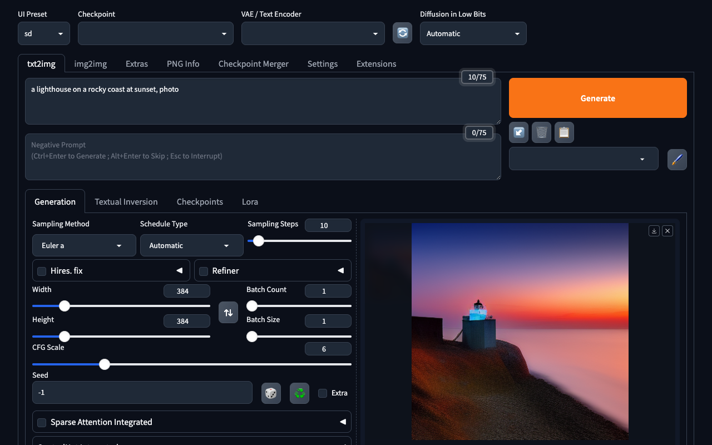

### [Forge Neo](https://github.com/Haoming02/sd-webui-forge-classic/tree/neo)

> Handle: `forge`<br/>
> URL: [http://localhost:35120](http://localhost:35120)

Stable Diffusion WebUI Forge - Neo is an actively maintained continuation of Forge, the
performance-focused fork of AUTOMATIC1111's Stable Diffusion WebUI. On top of the familiar A1111
txt2img/img2img UI it supports newer model families (Flux, Chroma, Qwen-Image, Z-Image, Wan 2.2
video, etc.).

Harbor builds the image from `services/forge/Dockerfile`, a rewrite of upstream's
[`neo/docker`](https://github.com/Haoming02/sd-webui-forge-classic/tree/neo/docker) Dockerfile.
It differs from upstream in four ways:

- It uses CUDA 13 and cu130 PyTorch instead of CUDA 12.6 and cu126. cu126 has no kernels for
  RTX 50-series (Blackwell, `sm_120`) GPUs, and Forge reports the resulting CUDA error as
  "Out of Memory".
- It runs as your host user instead of a fixed UID 99, so everything in the workspace stays
  owned by you.
- It installs Forge's Python requirements at build time instead of on every container start.
- It builds for both amd64 and arm64.



> [!IMPORTANT]
> Forge needs an **NVIDIA** GPU. The default CUDA 13 build requires driver `580+` and drops
> support for GPUs older than Turing (RTX 20-series), e.g. GTX 10-series. For those, build with
> CUDA 12.6 instead:
>
> ```bash
> harbor config set forge.cuda_version 12.6.3
> harbor config set forge.torch_index cu126
> harbor build forge
> ```
>
> Harbor's `nvidia` / `cdi` capability overlays pass the GPU through automatically. There is no
> ROCm variant. Without a GPU it only runs on the CPU with
> `harbor config set forge.args "--skip-torch-cuda-test --cpu"`, which is only usable for smoke tests.

#### Starting

```bash
harbor build forge
harbor up forge --open
```

The build clones the Forge Neo source and installs PyTorch and all of Forge's requirements
(several GB). Run `harbor build forge` again to update to the latest upstream commit. The image
bakes in your `HARBOR_USER_ID` / `HARBOR_GROUP_ID`, so rebuild it after those change or on a
different host. Startup itself takes about 10-20 seconds. Watch progress with:

```bash
docker logs -f harbor.forge
```

Forge comes with no models. Put checkpoints into the workspace before generating, for example:

```bash
# Stable Diffusion 1.5 (~2 GB)
curl -L -o services/forge/workspace/models/Stable-diffusion/sd15.safetensors \
  https://huggingface.co/Comfy-Org/stable-diffusion-v1-5-archive/resolve/main/v1-5-pruned-emaonly-fp16.safetensors
```

Then press the refresh button next to the checkpoint selector in the UI. See
[upstream's model guide](https://github.com/Haoming02/sd-webui-forge-classic/wiki) for the
layout that Flux, Qwen-Image, and Wan models need: diffusion model, text encoders and VAE go in
separate folders.

#### Configuration

##### Environment Variables

Following options can be set via [`harbor config`](./3.-Harbor-CLI-Reference.md#harbor-config):

```bash
# Web UI / API port on the host
HARBOR_FORGE_HOST_PORT      35120

# Forge Neo source the image is built from (branch or tag after #)
HARBOR_FORGE_GIT_REF        https://github.com/Haoming02/sd-webui-forge-classic.git#neo

# nvidia/cuda runtime base image version (build arg)
HARBOR_FORGE_CUDA_VERSION   13.0.2

# PyTorch wheel index (https://download.pytorch.org/whl/<index>) (build arg)
HARBOR_FORGE_TORCH_INDEX    cu130

# Persistent data root (models, output, extensions, config, cache)
HARBOR_FORGE_WORKSPACE      ./services/forge/workspace

# Extra launch flags appended after "--listen", e.g. "--api" (enables the
# A1111-compatible /sdapi/v1 API), "--xformers" or "--sage". Flags that
# install extra packages (--xformers, --sage, --flash, --nunchaku)
# install them on every fresh container start (from the pip cache after
# the first time).
HARBOR_FORGE_ARGS           ""
```

```bash
harbor config set forge.args "--api --sage --pynvml"
harbor restart forge
```

Changes to `HARBOR_FORGE_GIT_REF`, `HARBOR_FORGE_CUDA_VERSION` or `HARBOR_FORGE_TORCH_INDEX` only
take effect after `harbor build forge`.

`HARBOR_HF_TOKEN` is passed to the container as `HF_TOKEN` for gated Hugging Face downloads.
Additional environment variables can be set with `harbor env forge <key> <value>`.

##### Volumes

All paths are relative to `HARBOR_FORGE_WORKSPACE`:

- `models` → `/home/forge/sd-webui/models` contains checkpoints (`Stable-diffusion`), `VAE`,
  `Lora`, `ControlNet`, `ESRGAN`, text encoders, etc.
- `output` → `/home/forge/sd-webui/output` contains generated images.
- `extensions` → `/home/forge/sd-webui/extensions` contains extensions installed from the UI.
- `config` → `/home/forge/sd-webui/config` contains `config.json`, `ui-config.json`,
  `styles.csv` and `user.css` (the entrypoint symlinks them into place).
- `cache` → `/home/forge/.cache` contains the pip cache for optional packages installed at launch
  and Hugging Face downloads.

A `forge-init` sidecar creates these five directories owned by your host user before Forge
starts, since Docker would otherwise create them as `root`.

#### Integrations

**Reverse proxy**

With `traefik` present, `compose.x.traefik.forge.yml` routes `https://forge.${HARBOR_TRAEFIK_DOMAIN}`
to the UI.

**GPU**

`compose.x.forge.nvidia.yml` (nvidia driver) and the generated `compose.x.forge.cdi.yml` pass all
NVIDIA GPUs through.

#### Troubleshooting

```bash
docker logs harbor.forge
```

`harbor logs forge` also works but tails by default.

- **"Encountered Out of Memory during Sampling" with plenty of VRAM**: Forge reports every
  CUDA error as an OOM. The usual cause is a PyTorch build without kernels for your GPU, for
  example a `cu126` build on an RTX 50-series card, or `cu130` on a GTX 10-series card. Check with
  `docker exec harbor.forge python -c "import torch; torch.ones(1, device='cuda') + 1"`, then
  adjust `forge.torch_index` / `forge.cuda_version` and rebuild.
- **Container fails to start with `unsatisfied condition: cuda>=13.0`**: your NVIDIA driver is
  older than 580. Update it, or build with CUDA 12.6 / `cu126` as shown above.
- **`Found no NVIDIA driver` / `Torch is not able to use GPU`**: the NVIDIA capability was not
  detected. Check `harbor doctor` and the NVIDIA Container Toolkit setup.
- **"You do not have any model"** in the logs: expected until a checkpoint is placed under
  `models/Stable-diffusion`.

#### Links

- [GitHub Repository (neo branch)](https://github.com/Haoming02/sd-webui-forge-classic/tree/neo)
- [Upstream Docker notes](https://github.com/Haoming02/sd-webui-forge-classic/tree/neo/docker)
- [Wiki](https://github.com/Haoming02/sd-webui-forge-classic/wiki)
